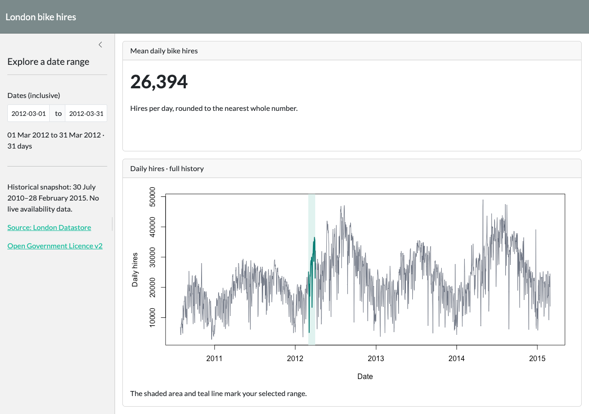

```{r}
source("R/bike_hires.R")
cycledata <- read_bike_hires("tfl-daily-cycle-hires.csv")
```

## Introduction {#introduction}

### London bike hires, in context

Explore **average daily hires** over a chosen date range.

- The historical dataset and its provenance
- What the application measures
- A reproducible R calculation
- Using the Shiny application

## Data set for application {#dataset}

{height=230}

- **1,675 daily records:** 30 July 2010–28 February 2015.
- Original [London Datastore cycle hire dataset](https://data.london.gov.uk/dataset/number-bicycle-hires).
- Published under the [UK Open Government Licence v2](https://www.nationalarchives.gov.uk/doc/open-government-licence/version/2/).
- The historical CSV is preserved unchanged.

## Intent {#intent}

- Choose an inclusive date range and see **mean daily hires**.
- View the full history with the selected period highlighted.
- Compare historical demand across seasons and years.

This is a historical exploration tool. Daily hire totals do **not** measure
live bike availability, and the app does not forecast demand.

## Code usage {#code-usage}

March 2012, using the same calculation as the app:

```{r}
#| echo: true
march <- summarise_hires(cycledata, "2012-03-01", "2012-03-31")
march$mean
```

**`r march$days` days · `r format(march$mean, big.mark = ",")` hires per day**

Both endpoints are included; only the daily date and hire-count columns are used.

## Application usage {#application-usage}

{height=390}

Choose start and end dates. The summary, rounded mean, and highlighted chart
update automatically. Run locally with `shiny::runApp()`.
